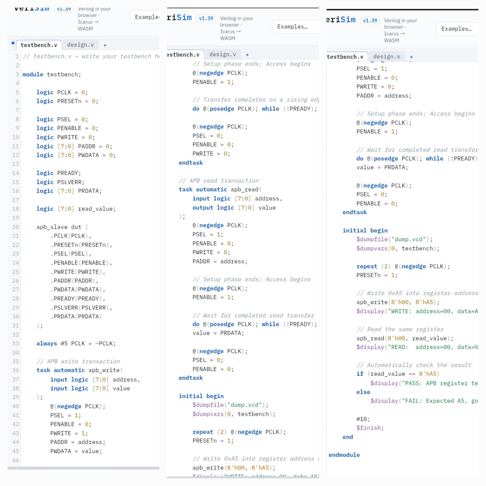
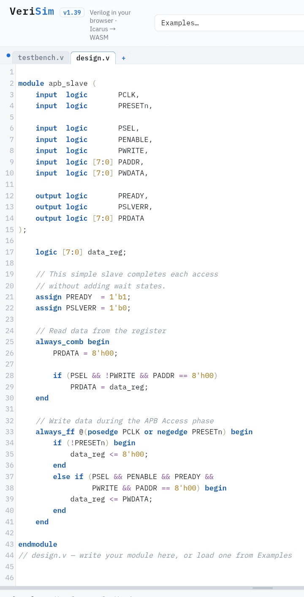
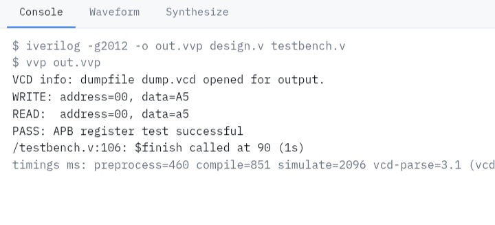
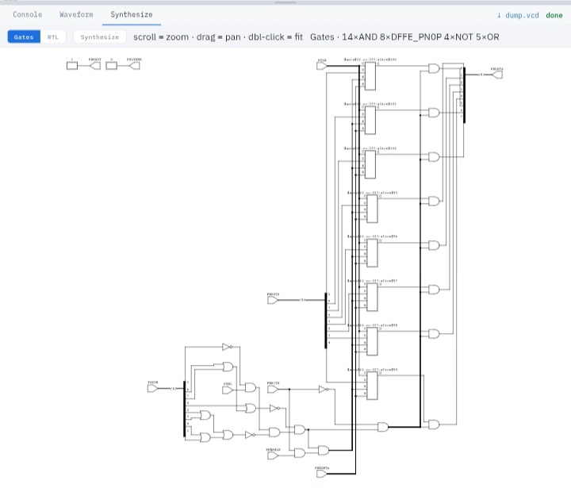

# APB GPIO-Style Register: RTL Design and Simulation

We will design a simple APB-compatible hardware block using SystemVerilog RTL, simulate it, and verify its output using a testbench.

The hardware block will act as an 8-bit register that supports writing data through the APB interface and reading the stored data back.

# 1. Hardware Block Overview

—The design consists of two main components:

```APB Slave Register (apb_slave.sv):``` Implements the APB interface and stores 8-bit data.

```Testbench (testbench.v):```
Acts as an APB master, performs read and write transactions, and checks the output.
FOR-```Testbench.sv```



For-```Design.sv```



For-```Output```



### Signal Reference Table

| Signal Name | Direction | Function |
|---|---|---|
| `PCLK` | Input | The clock signal that synchronizes hardware operations. |
| `PRESETn` | Input | Active-low reset signal. When `0`, the register is reset to `0`. |
| `PSEL` | Input | Selects the APB slave for a transaction. |
| `PENABLE` | Input | Indicates that the APB Access phase is active. |
| `PWRITE` | Input | Determines the transaction type: `1` for write and `0` for read. |
| `PADDR` | Input | Carries the address of the register being accessed. |
| `PWDATA` | Input | Carries the data that the master wants to write. |
| `PREADY` | Output | Indicates that the slave is ready to complete the transfer. |
| `PSLVERR` | Output | Indicates whether an APB transfer has an error. |
| `PRDATA` | Output | Carries the data returned by the slave during a read transaction. |
| `data_reg` | Internal | An 8-bit register that stores the written data. |

—These are the signals used in making of above resistor. 

—If we synthesis our resister at gate level it lokes like this:-



# 2. Understanding the Simulation Output

The testbench performs two operations: writing data into the register and reading the same data back.

Expected console output:

```text
PASS: Read data = a5
```

## Step 1: Reset the Register

Initially, `PRESETn = 0`.

The reset logic sets:

```systemverilog
data_reg <= 8'h00;
```

This initializes the register to zero.

## Step 2: Write Data into the Register

The testbench sends the following values:

| Signal | Value | Meaning |
|---|---|---|
| `PSEL` | `1` | Select the APB slave. |
| `PWRITE` | `1` | Perform a write transaction. |
| `PADDR` | `00` | Access register address `0x00`. |
| `PWDATA` | `A5` | Write hexadecimal data `A5`. |
| `PENABLE` | `1` | Enter the Access phase. |
| `PREADY` | `1` | The slave can complete the transfer. |

At the active rising edge of `PCLK`, the register stores the data:

```systemverilog
data_reg <= PWDATA;
```

Therefore:

`data_reg = 8'hA5`

The register now stores the value `A5`.

## Step 3: Read the Stored Data

The testbench starts another APB transaction with:

- `PWRITE = 0`, meaning read.
- `PADDR = 0x00`, selecting the same register.
- `PSEL = 1`, selecting the slave.

The read logic assigns:

```systemverilog
PRDATA = data_reg;
```

Therefore, `PRDATA` becomes `A5`, which is the value previously stored in the register.

## Step 4: Verify the Result

The testbench checks:

```systemverilog
if (PRDATA == 8'hA5)
    $display("PASS: Read data = %h", PRDATA);
else
    $display("FAIL: Read data = %h", PRDATA);
```

Because the returned value matches the expected value, the simulation prints:

`PASS: Read data = a5`

Here, `a5` is simply the hexadecimal representation of `A5`; uppercase and lowercase letters represent the same value.
