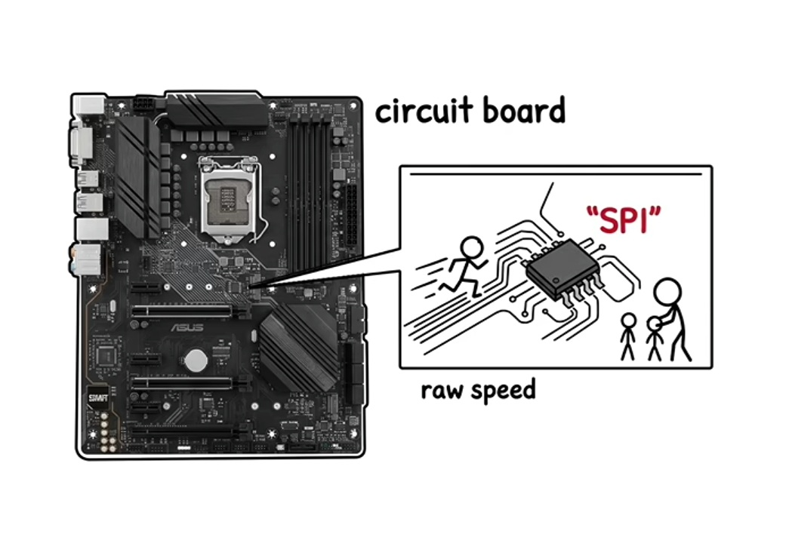
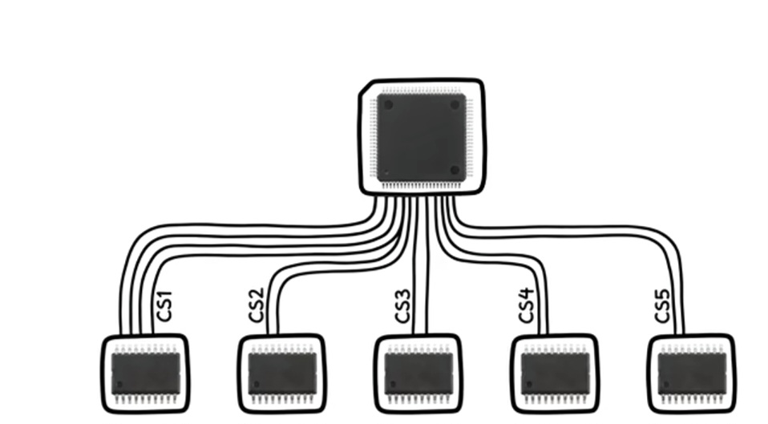
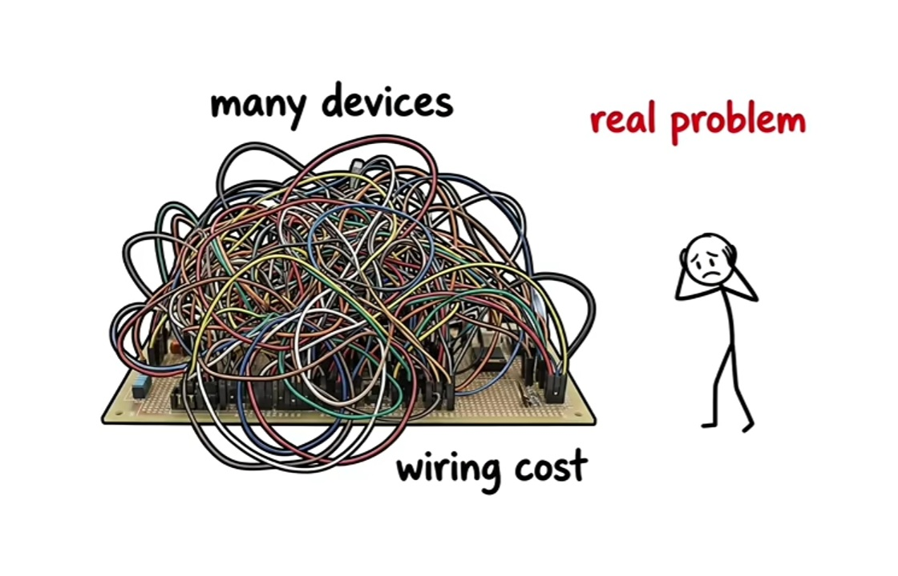
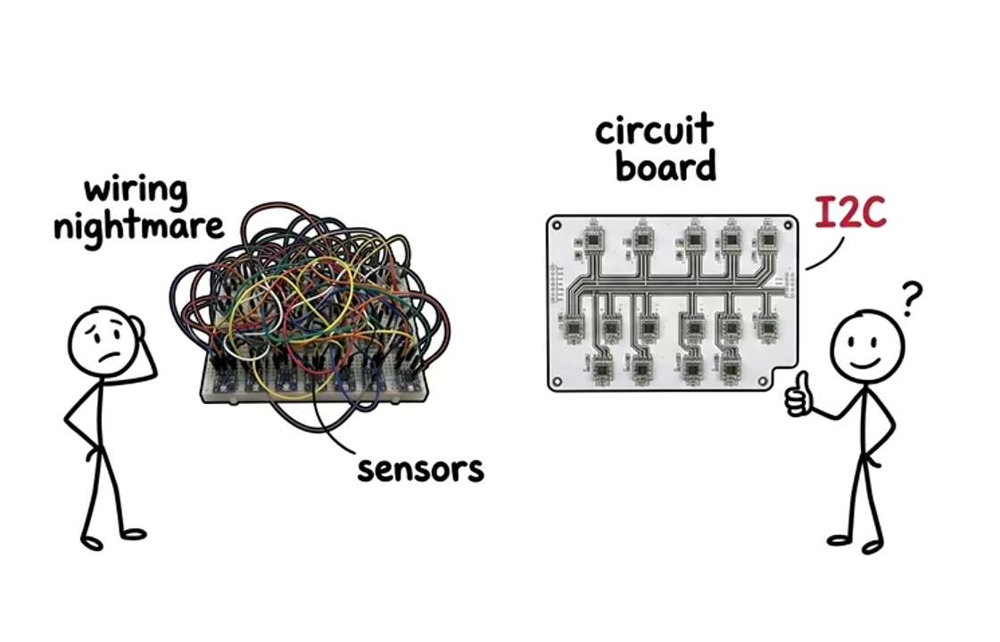
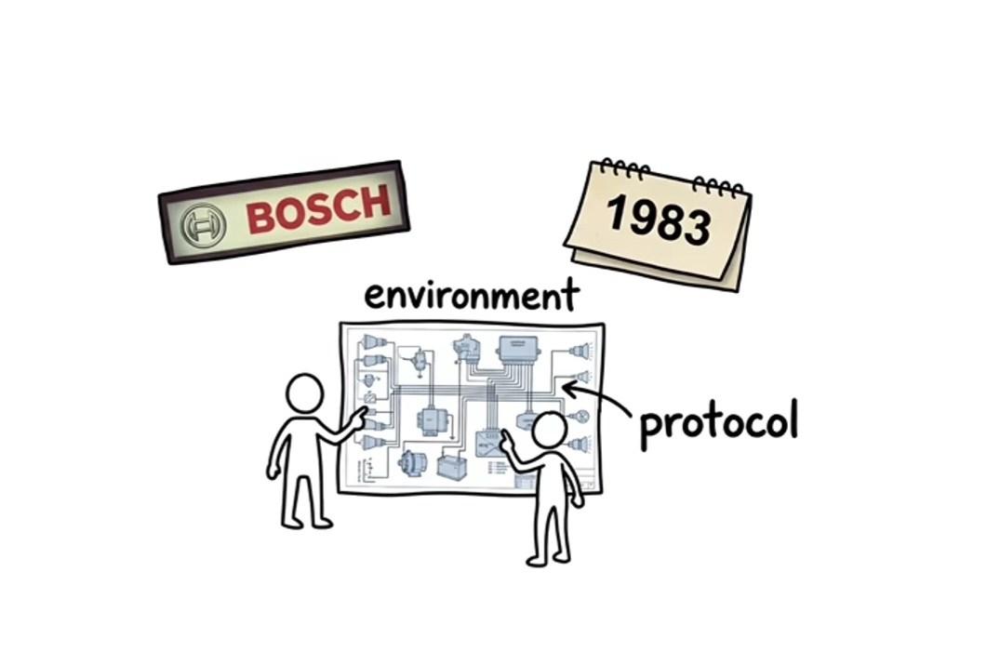
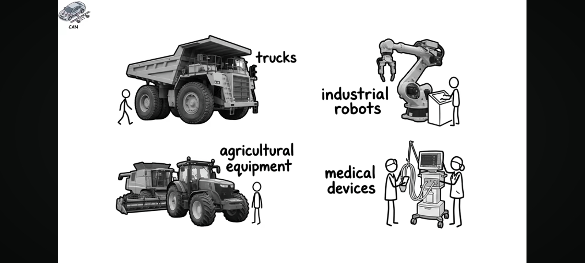
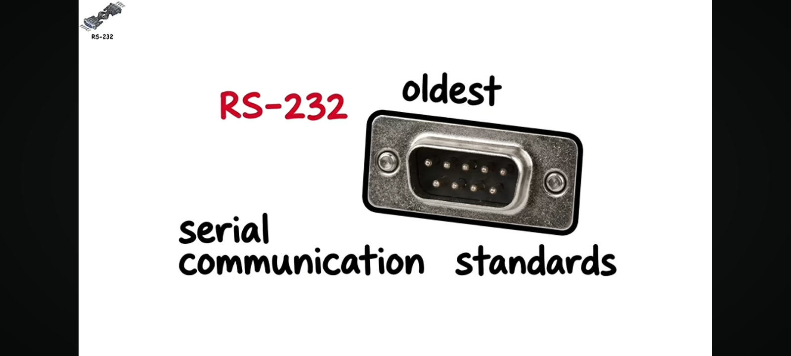
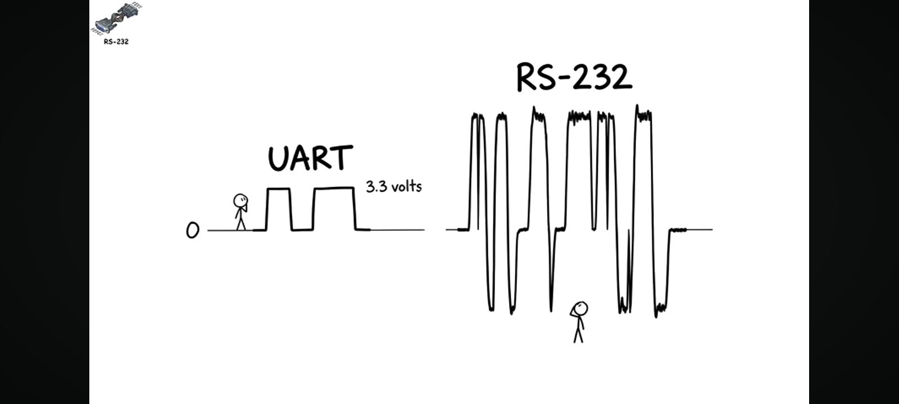
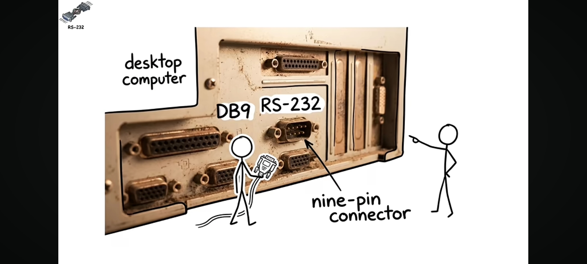
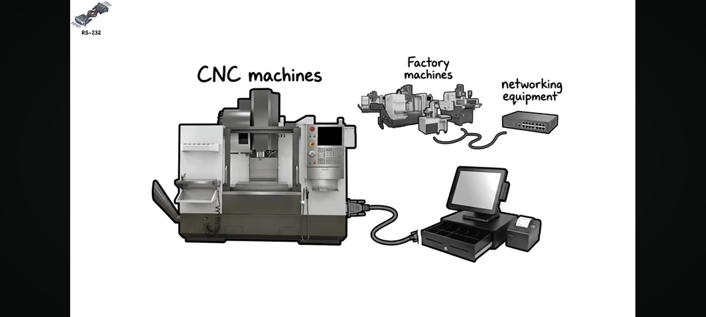

# Protocol Specification

Defines the meaning of signals and the rules for their timing and behaviour.

# RTL

Implements these rules in hardware, and the synthesised circuit produces and receives signals through physical connections.

# Protocols

## 1. UART (Universal Asynchronous Receiver-Transmitter)


1. Simplest way to communicate.
2. Uses only 2 wires to communicate.
   - Transmission wire [TX]
   - Receiver wire [RX]

   
   
4. ASYNCHRONOUS :- Does not use any clock pulse, so devices rely on baud rate (e.g., 9600, 115200).
5. Used in:
   - Arduino Board
   - GPS
   - Bluetooth adapter cable
   - USB
6. Only connects two devices point-to-point.
7. No inbuilt error correction, so if data gets corrupted during transmission, no one knows until you check manually.
8. Easy to set up, so engineers use it everywhere.


# 2. SPI (Serial Peripheral Interface)



1. SPI is a serial peripheral interface.
2. It is good in protocol speed and performance compared to UART.
3. It uses 4 wires

1. **SS/CS** →If multiple slaves connect with master, then for every slave, SS/CS line is separate.

2. **SCLK** → Serial clock to provide clock signals.
4. **MOSI** → Master Out Slave In  
   → Line to send data from Master.
   
6. **MISO** → Master In Slave Out  
   → Line to receive data from Slave.
   

## Data Transfer

1. **Half Duplex:** One of them can send data to another at one time.

2. **Full Duplex:** Both of them can send data to each other at a time.

## Diagram

```text
          MOSI
Master ───────────────► Slave

          MISO
Master ◄─────────────── Slave

          SCLK
Master ───────────────► Slave

          SS/CS
Master ───────────────► Slave
```
5. Some SPI devices can operate at high speeds about 50 mbps.
6. We see it in:
   - SD cards
   - Flash memory
   - Display screens

7. Disadvantage:
   - To connect multiple devices, we need a separate CS (Chip Select) wire for each device.


   - To use with more device there is lote of wire we need to use and it is an disadvantage
   - 
   

8. When to use:
   - In a circuit board where fast speed is required but fewer devices are connected.

# 3. I²C (Inter-Integrated Circuit)


1. It removes the biggest disadvantage of SPI.
2. It uses only 2 wires:
   - SCL (Serial Clock Line)
   - SDA (Serial Data Line)

3. Over 127 devices can be connected using these 2 wires, depending on device addresses and bus configuration.

4. We use it in:
   - Temperature sensors
   - OLED displays
   - Gyroscopes
  
# CAN (Controller Area Network)

1. CAN stands for **Controller Area Network**.
   
   
3. It is generally used in automobiles and robotics.
   
   
4. It uses only two wires:
5. **CAN-H (CAN High)**
6. **CAN-L (CAN Low)**.
   
7. It connects multiple devices that communicate with each other continuously.
   
8. It is not very fast compared to some other communication protocols and can be complex.

---

# RS-232


1. **Point-to-Point Communication**
   - Connects two devices directly without a bus or network.
   - Communication takes place through a serial connection.
   - It represents binary `0` and `1` using different voltage levels.
   - the voltage level it use is about
 -15 to 15 volt while uart is only use -3.3 to 3.3 volt
     

2. **Applications**
   - Factory machines
   - Networking equipment
   - CNC machines



